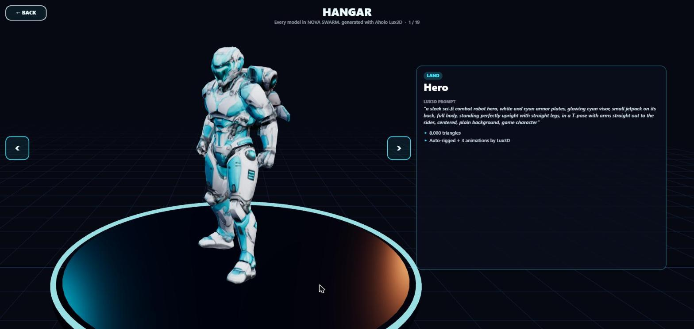
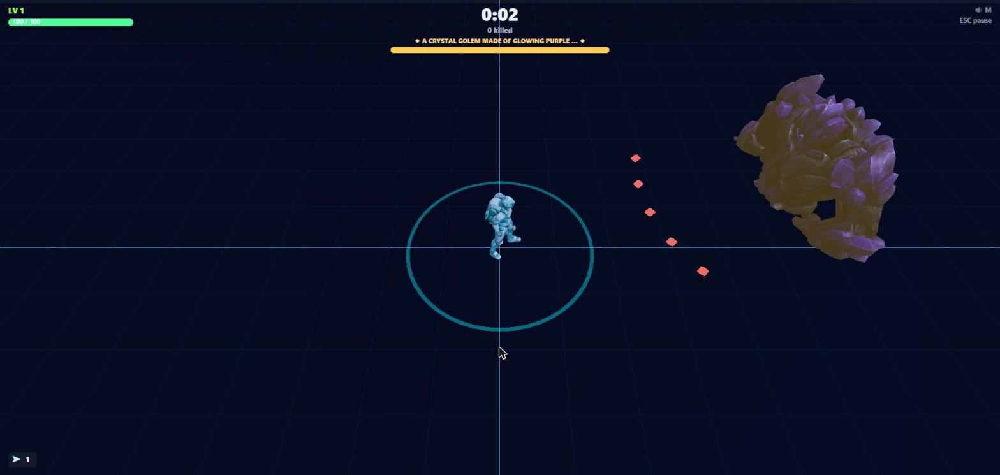
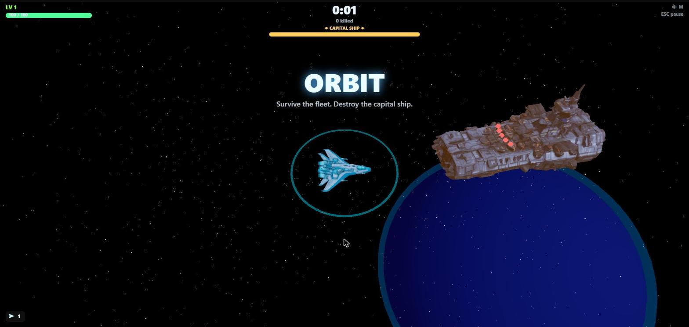
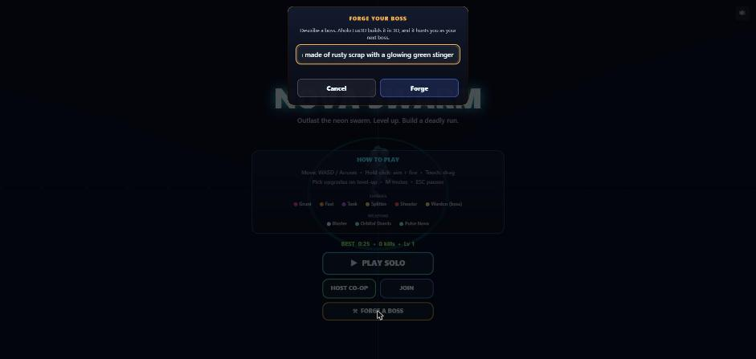
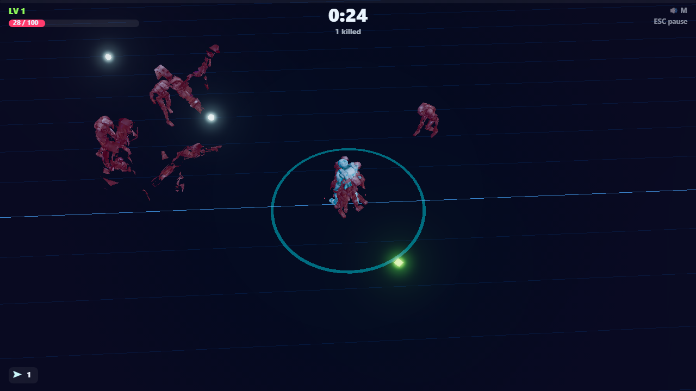
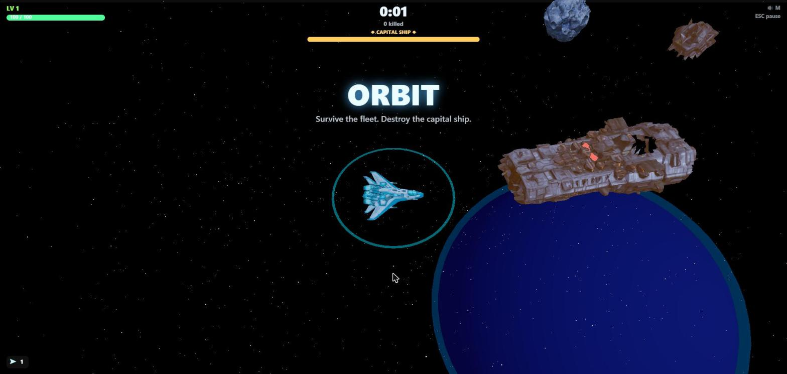

# NOVA SWARM: The Generated Swarm

**A browser 3D roguelite where every character, ship, rock and boss is generated by [Aholo Lux3D](https://lux3d.aholo.ai/), and the next boss is whatever *you* type.**

Built for the **Manycore Aholo Global 3D AI Hackathon**.

- 🎮 **Play it:** https://aholo.vercel.app/ (desktop or phone, no install)
- 📦 **Source:** https://github.com/rohanjain1648/AHOLO
- 🕹 **Fastest tour:** open the live link, press **HANGAR** to see all 19 Lux3D models and the prompts behind them, then **FORGE** to type a boss into existence, then **PLAY SOLO**.

| Hangar | Boss intro (Forge boss) | Orbit: capital ship |
|---|---|---|
|  |  |  |

| Prompt → boss | Shatter death | Capital ship, stage two |
|---|---|---|
|  |  |  |

---

## What it is

NOVA SWARM is a wave-survivor in the vein of *Vampire Survivors*: you steer and aim a blaster while your other weapons fire themselves, and every level-up lets you pick one of three upgrades. Positioning and build are the game.

For the hackathon it was rebuilt around Lux3D, and grew a second half:

- **Every model in the game is Lux3D-generated.** The hero, five land enemy types, the Warden boss, the orbital fighter, four space enemy types and the capital ship: 13 models, plus 6 pre-forged bosses. Humanoids are auto-rigged and animated by Lux3D's own rig and animation APIs.
- **A run climbs from the surface into orbit and back.** Beat the Warden, launch, fight a drifting-ship dogfight against a generated fleet, destroy the capital ship, re-enter, and do it again against a tougher swarm.
- **Forge: you author the boss.** Type "a giant mechanical scorpion made of rusty scrap". A Lux3D job runs while you play, and the next boss that arrives *is* your scorpion, with your words on its health bar.

---

## How Lux3D is used

Lux3D is not decoration here. The game has no other character art: the cast comes out of the pipeline below, and the player can generate more at runtime.

### The asset pipeline: `tools/lux3d/`

```
 prompt ──► text-to-3D ──► auto-rig ──► animation retarget ──► download ──► optimize ──► manifest.json
 (cast.mjs)  (G1, 5 min)   (humanoids)   (Idle/Walk/Sprint/Death)           (local)      (game reads it)
```

| Lux3D API | Used for |
|---|---|
| `text-to-3d` (G1) | All 13 hand-prompted cast models |
| `text-to-3d` (G1-Turbo) | Forge bosses and the 6 gallery bosses (about 2 minutes each, up to a few minutes live) |
| `animations/rig` | Auto-rig the hero, grunt, fast, tank and Warden |
| `animations/retarget` | Lux3D animation clips (Idle, Zombie Walk, Jog, Sprint, Death, Hit) on those rigs |
| `part-split` | Splits the capital ship so its **bridge blows off** at half health |

Not used: image-to-3D, material transfer, articulation, the World/SpatialGen API, RenderCloud, LuxReal.

What the pipeline does, beyond calling the API:

- **Prompts are the source of truth.** [`tools/lux3d/cast.mjs`](tools/lux3d/cast.mjs) lists every model with its prompt, style, rig type, animations and triangle budget. Humanoids are prompted in an upright T-pose, because the auto-rigger rejects bent knees (`MODEL_NOT_RIGGABLE`). The first grunt ("hunched posture") was rejected that way. That failure and its fix are in the report.
- **Resumable and frugal.** Every task id and result URL is saved to `state.json` after each step, so a crash or a dropped download never pays for the same task twice. It is a **dry run unless you pass `--yes`**.
- **Shrunk for the web and for phones.** `gltf-transform` + `meshoptimizer` weld, simplify to a triangle budget, resample animation, convert textures to WebP and meshopt-compress. The grunt went from **22 MB / 12.7k triangles to 367 KB / 5.5k**. All 13 cast models together are about **3.5 MB**.
- **Every model leaves a log** in `tools/lux3d/log/` (prompt, task ids, per-step timings, triangle counts, clip names), the raw material for the project report.

### Forge: Lux3D at runtime

```
 player types a prompt ─► relay /forge ─► Lux3D G1-Turbo ─► GLB URL ─► game loads it ─► next boss wears it
                          (holds the key)                   (CDN, CORS *)
```

- The Lux3D key lives **only on the relay server**. The browser sends a prompt and gets back a job id, then a model URL. Nothing secret reaches the page.
- Because each forge spends credits, the relay cleans and length-limits prompts, **rate-limits each address (3/hour)** and has a **daily cap (40)**.
- **A pre-forged gallery keeps Forge working when live generation can't**: relay offline, rate limit hit, daily cap, a failed job, or credits gone. The game picks the gallery boss whose prompt best matches what you typed and says so plainly ("Live Forge is busy. Pre-forged boss: …"). Gallery bosses are lazy-loaded, so they cost nothing at startup.
- In co-op, the host shares its Forge boss (the live URL or the gallery entry), so everyone fights the same creature.

### Part split: a two-stage capital ship

Lux3D's part split separated the capital ship into **hull and command bridge**. At half health the bridge tears off and tumbles away, leaving a scorched gap in the hull; the ship fires about 50% faster. Co-op clients see it too.

### Hangar: proof you can inspect

**HANGAR** on the title screen opens a turntable showroom of all 19 models. Each card shows what the model does in the game, **the exact Lux3D prompt**, triangle count, whether Lux3D rigged it, and its animation clips. Characters cycle through their Lux3D animations on the pedestal.

---

## The game

### A run

```
 SURFACE ──(kill the Warden)──► LAUNCH ──► ORBIT ──(destroy the capital ship)──► RE-ENTRY ──► SURFACE (loop 2: enemies ×1.35 HP)
 waves, XP, upgrades           4 s         drift flight, fleet, asteroids,        3 s
                                           capital ship after 40 s
```

- **Surface:** grunts, fast runners, tanks, splitters (burst into two fast robots), shooter drones, and the **Warden** every two minutes.
- **Launch:** the field clears, the ground drops away and the camera swoops up through the atmosphere.
- **Orbit:** your robot swaps to a Lux3D fighter that **thrusts and drifts** and banks into turns. Enemies: weaving **interceptors**, **kamikazes** that detonate on contact, gunship **bombers**, and drifting **asteroids**. After 40 seconds the **capital ship** warps in.
- **Boss intro:** when a boss arrives, letterbox bars slide in, the camera swoops to it and its name fills the screen. Players are invulnerable for those 2.6 seconds.
- **Shatter deaths:** a dying enemy's *own Lux3D model* breaks into chunks that fly out, spin, and shrink away.
- Beating a boss repairs 35% of your health.

### Controls

| | |
|---|---|
| **Move** | `WASD` / arrow keys (touch: drag) |
| **Aim + fire** | Hold the mouse button; shots go toward the cursor. On touch, firing follows your drag |
| **Dash** | `Shift` or `E`: a 0.15 s invulnerable burst, 2.4 s cooldown (an afterburner in orbit). Desktop only for now |
| **Level up** | Click a card or press `1` / `2` / `3` |
| **Ping** (co-op) | `G` |
| **Pause / mute** | `Esc` or `P` / `M` |

### Weapons and upgrades

Five weapons and 19 upgrades. Blaster (start), **Orbital Shards**, **Pulse Nova**, **Chain Lightning** (arcs from the nearest enemy to its neighbours, 15% softer per jump) and **Rail Lance** (a piercing beam through everything in line), plus stat upgrades: HP, regen, armor, speed, crit, magnet radius and XP gain.

### Co-op, spectators and chat

- **2–4 player co-op** with a 4-letter room code or an invite link. Team XP, personal builds, downed-not-dead with teammate revive, pings. The host's phases, forged boss and capital-ship stage are synced to everyone.
- The base game's crossplay with its Android app uses the older network format, so **this build's rooms are web-only until the app is updated.**
- **Spectators** can watch a room by link.
- **Squad chat, quick-chat and crowd voting** are built on Nexconn. They need Nexconn keys on the relay; without them the game runs without chat.

---

## What existed before, and what was built for this hackathon

This project **builds on an existing game**, and that is disclosed rather than hidden.

**Existing base** (imported unchanged as the first commit, `ed98675`): a fixed-timestep simulation with object pools and a spatial hash; the Three.js rendering pipeline (selective bloom, instanced effects, follow camera); procedural Web Audio; one CC0 robot model used for every character; 3 weapons, 15 upgrades, 5 enemy types and a boss; the co-op relay (Node + `ws`), binary snapshots, crossplay with the Android app; and the Nexconn chat/spectator code.

**Built for the hackathon** (everything else in this repo's history):

- the Lux3D asset pipeline, model manifest and runtime model loader, replacing the single shared robot
- all 19 Lux3D models, with prompts, and the Hangar
- the surface → launch → orbit → descent loop: drift flight, 4 space enemy types, the capital ship, phase visuals, loop scaling
- Forge, the relay endpoints and rate limits, the pre-forged gallery fallback, and co-op sync
- capital-ship part split (two-stage boss), shatter deaths, boss intro
- dash, Chain Lightning, Rail Lance
- a balance bot and the fixes it found (see below), and the test suite growing from 111 to 200 tests

---

## Run it locally

Requires **Node 22+**.

```bash
npm install
npm --prefix server install       # the relay's own dependencies
npm run dev                        # http://localhost:5173
```

The game runs fully offline from the models already in `public/models/`.

### Co-op and Forge locally

The relay (`server/`) handles co-op rooms, chat sessions and Forge. Give it your keys in `server/.env` (git-ignored):

```
LUX3D_API_KEY=...            # enables live Forge; without it the gallery fallback is used
NEXCONN_APP_KEY=...          # optional: squad chat / spectators / crowd voting
NEXCONN_APP_SECRET=...
FORGE_PER_IP_PER_HOUR=3      # optional limits (defaults shown)
FORGE_PER_DAY=40
```

```bash
npm --prefix server run dev                        # relay on ws://localhost:8787
VITE_RELAY_URL=ws://localhost:8787 npm run dev     # game, in a second terminal
```

### Generate models with Lux3D

Put your key in `.env.local` at the repo root (git-ignored) as `LUX3D_API_KEY=...`. Use `node` directly (PowerShell swallows the `--` in `npm run … -- …`):

```bash
node tools/lux3d/generate.mjs                              # dry run: shows what would be created, spends nothing
node tools/lux3d/generate.mjs --phase land --yes           # land cast (spends credits)
node tools/lux3d/generate.mjs --only enemy.grunt --yes
node tools/lux3d/generate.mjs --only enemy.grunt --reoptimize enemy.grunt   # redo the free local shrink step
node tools/lux3d/split.mjs enemy.capital --yes --install bridge             # part split, name the part, install it
```

### Dev tools

- `/tools/preview/index.html` on the dev server: every model seen from above with the game's forward axis drawn, for checking orientation.
- `npm run capture`: headless play that saves frames for the report.
- Dev-only URL switches: `?phase=launch|orbit`, `?boss=now` (`&bridge=off`), `?give=chain:3,lance:3`.

---

## Testing and balancing

```bash
npm test                    # 200 tests: simulation, snapshots, sessions, Forge, relay, chat
npm run typecheck
npm run build && npm run smoke        # headless browser: boots the build and plays
npm run smoke:coop                    # two browsers + a spectator through a real relay
npm run balance -- 60 --damage        # the balance bot (below)
```

**A bot plays the real simulation** (`tools/balance.ts`): it kites, focuses the boss, dashes out of trouble and picks random upgrades. It is a crude stand-in for a player, so its numbers are for *comparing settings*, not absolute truth. Over 60 runs per setting it found:

- A **crash that existed in the original game**: when a splitter died, a child could reuse its freed slot, wiping the split setting, and the second child threw. Fixed, with a regression test.
- **83% of all damage was the Warden's five-bullet fan.** Now three bullets, slower. The capital ship got the same treatment.
- Boss HP rode two scaling curves (about 2,800 at its 2:00 arrival); it now scales gently.
- Orbit difficulty followed total run time, so a late launch meant a late-game fleet. It now starts near the 1:15 level and climbs with time in orbit.
- Result: the bot's median survival went **from 2:50 to 8:45**; about 70% reach orbit and a third beat the capital ship. Dash is worth about 2½ minutes of survival, and the two new weapons about a minute and 35% more kills.

---

## Deploy

- **Game (static) → Vercel.** Framework preset Vite; build `npm run build`; output `dist`. Set `VITE_RELAY_URL=wss://<your-relay>.onrender.com` and `VITE_PUBLIC_URL=https://<your-site>` *before* deploying (they are baked into the build). Never give the Lux3D key a `VITE_` prefix.
- **Relay → Render.** New → Blueprint on this repo; [`render.yaml`](render.yaml) declares everything. Enter `LUX3D_API_KEY` (and optionally the Nexconn keys) when asked. The free plan sleeps after about 15 minutes idle; the title screen shows "Waking co-op server…" while it wakes.

---

## Architecture

```
src/
  core/      fixed-timestep loop, input, procedural audio, spatial hash
  game/      PURE simulation: world, player, enemies, upgrades, phases (no Three.js)
  render/    Three.js: scene, camera, model library + manifest, shatter, hangar, boss intro
  forge/     Forge client and the pre-forged gallery matcher
  ui/        canvas HUD, title, hangar screen, co-op lobby
  net/       relay protocol, binary snapshots, host/client sessions
  chat/      Nexconn chat, quick-chat, crowd voting
server/      relay (Node + ws): rooms, Forge endpoints, chat sessions. No game logic
tools/       lux3d/ (pipeline), preview/ (model viewer), balance.ts (bot)
public/models/   gen/*.glb (Lux3D), manifest.json, RobotExpressive.glb (fallback)
```

Three decisions worth knowing:

1. **The simulation never imports the renderer.** `World` holds plain pooled structs; `WorldView` reads them. That is why swapping the CC0 robot for 19 different Lux3D models touched no gameplay code, and why shatter deaths, the boss intro and co-op clients work from the same data.
2. **The manifest is the contract between the pipeline and the game.** `public/models/manifest.json` maps a role (`enemy.grunt`, `player.ship`, …) to a file, its clips, orientation and breakable part. It is validated at load, and anything malformed falls back to the bundled robot, so the game always runs.
3. **Co-op is host-authoritative.** The host runs the one real simulation; clients predict only their own movement and render interpolated snapshots. Phases, forged bosses and the capital ship's stage ride in the snapshot, so everyone sees the same fight.

[`docs/DESIGN.md`](docs/DESIGN.md) and [`docs/AI_WORKFLOW.md`](docs/AI_WORKFLOW.md) describe the **original base game** (before the hackathon); they are kept for the engine background but do not cover the Lux3D work above.

---

## Known limitations

- **Live Forge needs Lux3D credits.** Mine expire before judging ends, so the pre-forged gallery is the fallback and the game says when it is used.
- **Dash has no touch button yet.** The input system handles one finger at a time; a second-finger button is part of the mobile release.
- **The relay's free plan sleeps**, so the first co-op or Forge request after idle can take about a minute.
- **Gallery bosses take a few seconds to download** the first time you open them.
- **Squad chat and crowd voting** depend on Nexconn keys being set on the relay.
- The balance numbers come from a bot, not from playtesters.

## Roadmap

Mobile releases (the Android app needs updating to this build's network version to join its rooms), a touch dash button, more Lux3D features (image-to-3D companion from a photo, material transfer to re-skin enemies per sector), and more sectors with generated props.

---

## Credits and licenses

- **3D models:** generated with **Aholo Lux3D** (Manycore Tech) from the prompts in [`tools/lux3d/cast.mjs`](tools/lux3d/cast.mjs) and shown in the Hangar. Their use is governed by Aholo's terms.
- **Fallback robot:** [`RobotExpressive.glb`](https://github.com/mrdoob/three.js/tree/dev/examples/models/gltf/RobotExpressive) by Tomás Laulhé, **CC0 1.0**, via the three.js examples. It is only used if a Lux3D model fails to load.
- **Code:** MIT ([LICENSE](LICENSE)).
- **Libraries:** `three`, `ws`, `@nexconn/chat` and `@nexconn/engine`, `@gltf-transform/*`, `meshoptimizer`, `sharp`, `vite`, `typescript`, `vitest`, `playwright`.
- **Audio:** none; every sound is synthesized live in the Web Audio API.
- **AI assistance:** the game and pipeline were built with Claude Code as a pair-engineer.
